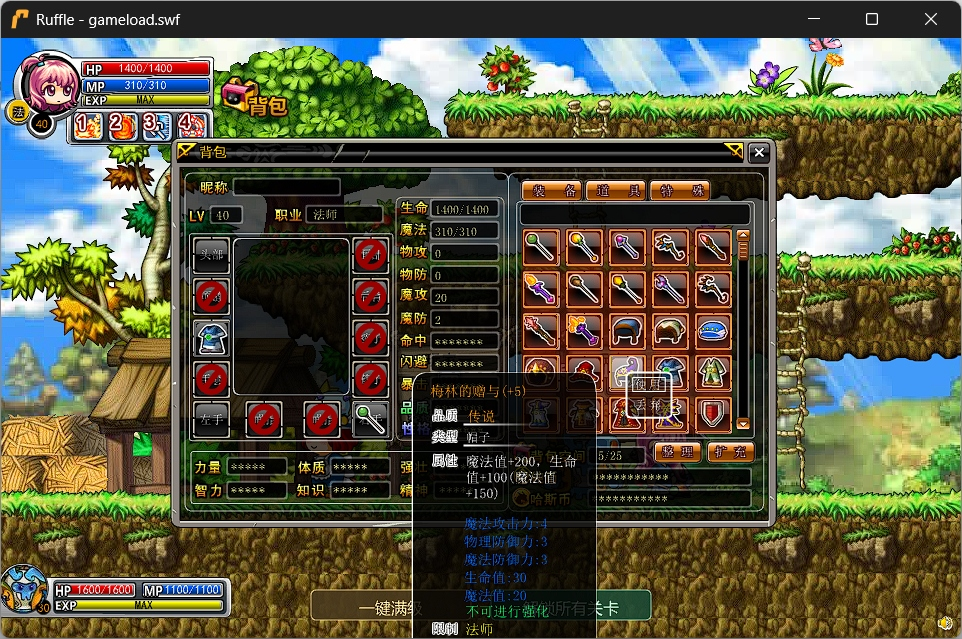

# 冒险王之神兵传奇 · Windows 便携版

基于《冒险王之神兵传奇幸运无敌版》的 Windows 离线便携版，双击即玩，无需安装 Flash 插件。

## 开始游戏

1. 解压到可写目录，确保 `Play.exe` 旁保留 `game`、`runtime` 和 `game.ini`。
2. 双击 `Play.exe` 启动游戏，载入后直接进入主菜单（单人／双人／继续存档／改键）。

## 主要改动

- **技能长按连发**：单人／双人均可长按技能键连续施放，沿用原有冷却与解锁规则。
- **关卡无敌开关**：进入第 1–13 关后，屏幕底部居中显示「无敌：关」按钮，点击切换。开启时角色与宠物立即回满生命和能量并维持满值；关闭后恢复原版规则。开关不写入存档，每次启动默认关闭。

- **家园快捷按钮**：新手村（关卡 0）底部提供「一键满级」与「解锁所有关卡」，点击需二次确认，用后本局隐藏，重启后重新出现：
  - **一键满级**：角色升至 40 级、宠物升至 30 级并补齐三阶形态（默认休息，需到精灵仓库出战）、按职业发放全套 `+5` 传说装备与五类宝石各 99 颗。背包装备栏默认容量已扩充至 60。
  - **解锁所有关卡**：直接解锁第 1–13 关。

- **宠物状态条修复**：宠物休息后，左下角／右下角的状态条会同步移除，重新召唤时再出现。

## 存档与设置

- **存档位置**：`data/saves`，备份或迁移时请先退出游戏再复制整个目录。
- **常用设置**：退出游戏后编辑 `game.ini`：
  - `[Game] ExperiencePerLevel`：每级所需经验（`0` 为原版曲线，默认 `50`）。
  - `[Window] Width` / `Height` / `Fullscreen` / `Volume`：窗口尺寸、全屏与音量。
